# 🇺🇸 Road Trip USA

<p align="center">
  <strong>EXPLOREZ L’HORIZON AMÉRICAIN.</strong><br>
  Des canyons de l’Ouest aux forêts de l’Est, choisissez votre route et partez à la découverte des grands espaces des États-Unis.
</p>

<p align="center">
  <a href="https://coco921609.github.io/Usa/"><strong>Découvrir l’application Web</strong></a>
  &nbsp;·&nbsp;
  <a href="https://github.com/Coco921609/Usa"><strong>Code source</strong></a>
</p>

<p align="center">
  
  
  
</p>

---

## ✦ L’esprit Road Trip USA

**Road Trip USA** est une application Flutter dédiée à la découverte des paysages naturels des États-Unis. Son point de départ invite à choisir un itinéraire : l’Ouest américain ou l’Est américain.

L’application présente les destinations à travers des fiches illustrées, des informations pratiques et des contenus conçus pour préparer une exploration à son rythme. L’interface est proposée en français et en anglais.

## ✦ Deux routes pour explorer l’Amérique

| ITINÉRAIRE | UNIVERS |
|:--|:--|
| 🏜️ **Ouest américain** | Canyons, déserts, formations rocheuses, lacs et paysages de l’Ouest |
| 🌲 **Est américain** | Forêts, montagnes, cascades et grands espaces de l’Est |

L’application regroupe **13 destinations à l’Ouest** et **4 destinations à l’Est**, avec des pages dédiées à chaque lieu.

## ✦ Le parcours de l’application

<p align="center">
  <strong>20 CAPTURES · FORMAT MOBILE · 2 ITINÉRAIRES</strong><br>
  <em>Découvrez séparément les écrans de l’Ouest et de l’Est américains.</em>
</p>

<p align="center"><em>Captures réalisées depuis les écrans Flutter · 430 × 932 px</em></p>

### 🏜️ Ouest américain

<p align="center"><em>De l’écran de sélection aux grands parcs et paysages de l’Ouest.</em></p>

<table>
<tr><td align="center"><strong>02 — Ouest américain</strong><br><a href="docs/screenshots/02-ouest-americain.png">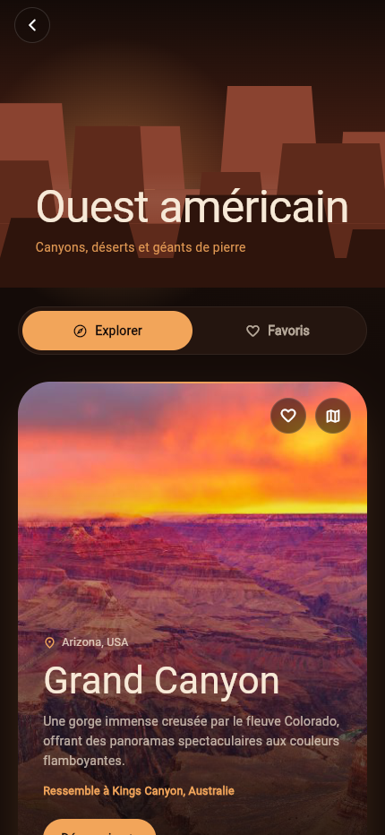</a></td><td align="center"><strong>04 — Grand Canyon</strong><br><a href="docs/screenshots/04-grand-canyon.png">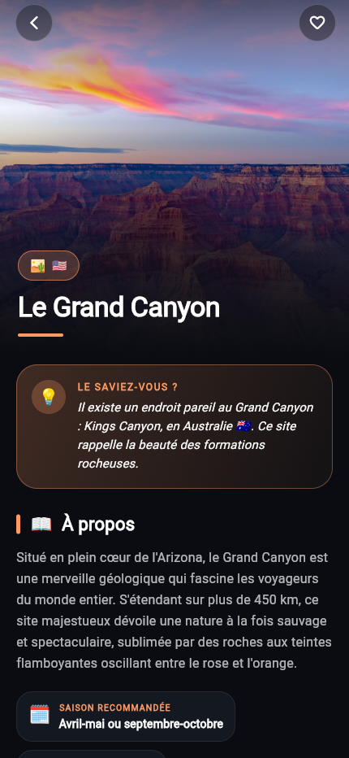</a></td><td align="center"><strong>05 — Monument Valley</strong><br><a href="docs/screenshots/05-monument-valley.png">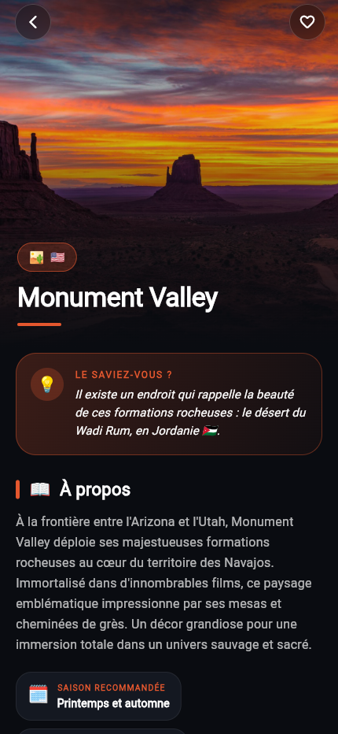</a></td></tr>
<tr><td align="center"><strong>06 — Yellowstone</strong><br><a href="docs/screenshots/06-yellowstone.png">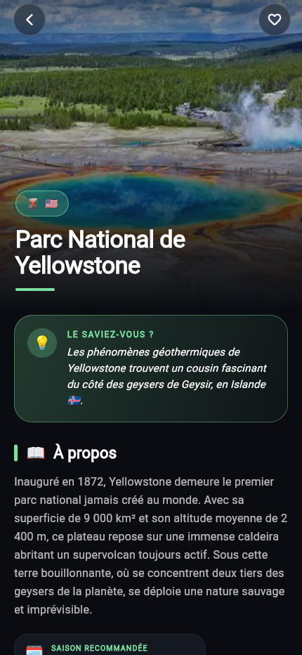</a></td><td align="center"><strong>07 — Death Valley</strong><br><a href="docs/screenshots/07-death-valley.png">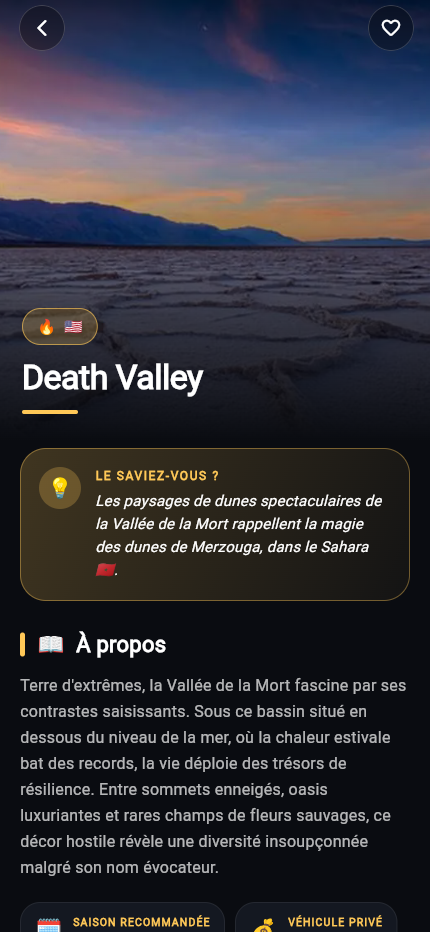</a></td><td align="center"><strong>08 — Antelope Canyon</strong><br><a href="docs/screenshots/08-antelope-canyon.png">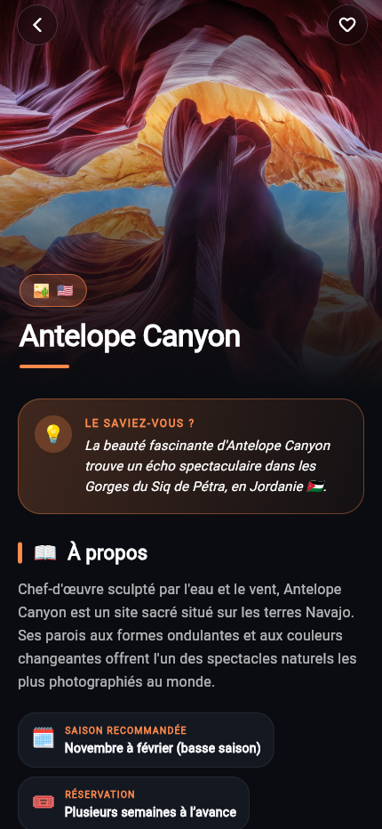</a></td></tr>
<tr><td align="center"><strong>09 — Canyonlands</strong><br><a href="docs/screenshots/09-canyonlands.png">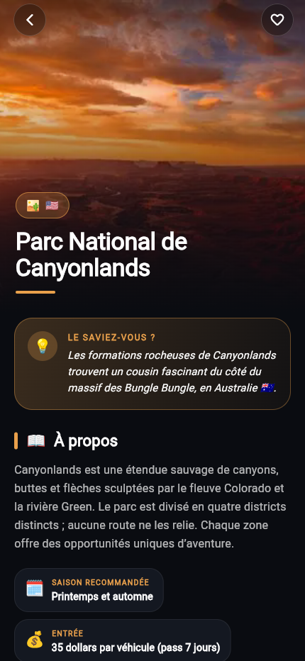</a></td><td align="center"><strong>10 — Bryce Canyon</strong><br><a href="docs/screenshots/10-bryce-canyon.png">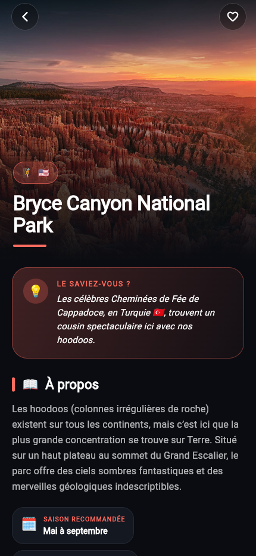</a></td><td align="center"><strong>11 — Zion</strong><br><a href="docs/screenshots/11-zion.png">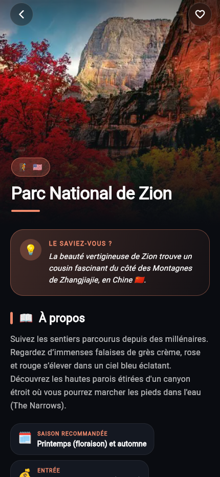</a></td></tr>
<tr><td align="center"><strong>12 — Lac Powell</strong><br><a href="docs/screenshots/12-lac-powell.png">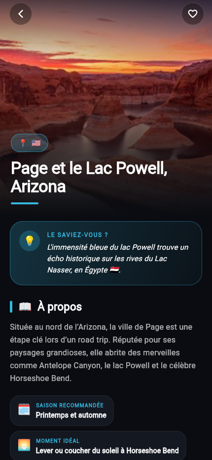</a></td><td align="center"><strong>13 — Vague pétrifiée</strong><br><a href="docs/screenshots/13-vague-petrifiee.png">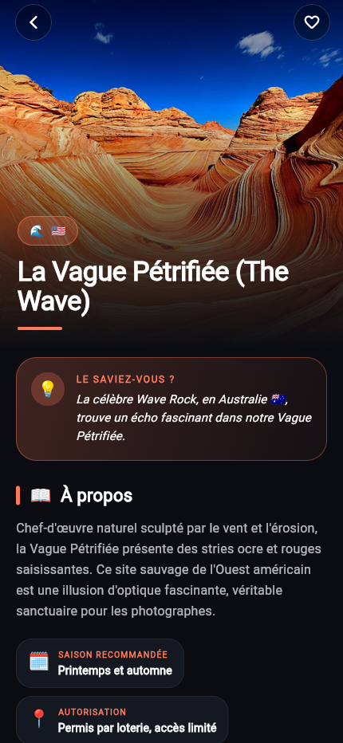</a></td><td align="center"><strong>14 — Dunes peintes</strong><br><a href="docs/screenshots/14-dunes-peintes.png">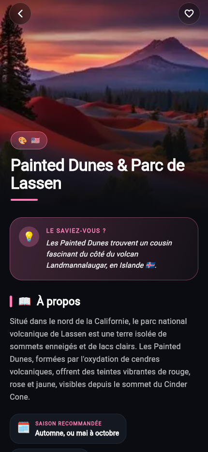</a></td></tr>
<tr><td align="center"><strong>15 — Lac Mono</strong><br><a href="docs/screenshots/15-lac-mono.png">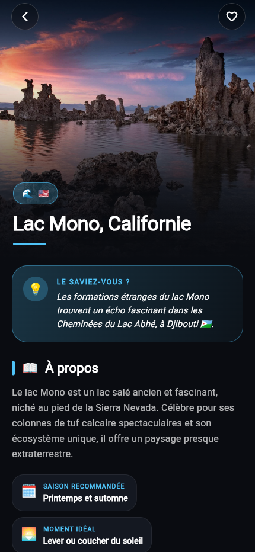</a></td><td align="center"><strong>16 — Fly Ranch Geyser</strong><br><a href="docs/screenshots/16-fly-ranch-geyser.png">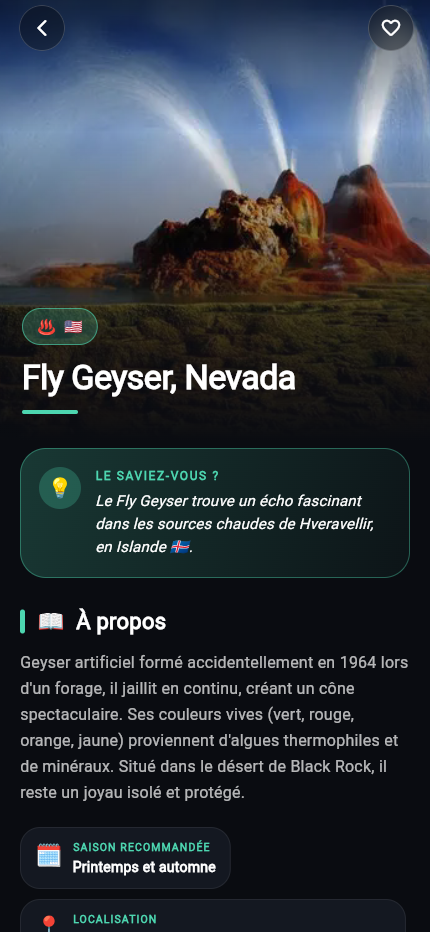</a></td><td></td></tr>
</table>

### 🌲 Est américain

<p align="center"><em>Les forêts, montagnes et grands espaces de l’Est.</em></p>

<table>
<tr><td align="center"><strong>03 — Est américain</strong><br><a href="docs/screenshots/03-est-americain.png">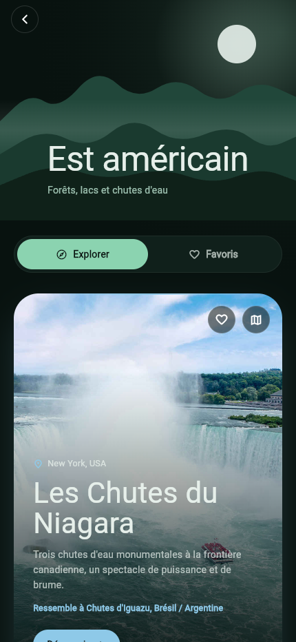</a></td><td align="center"><strong>17 — Chutes du Niagara</strong><br><a href="docs/screenshots/17-chutes-niagara.png">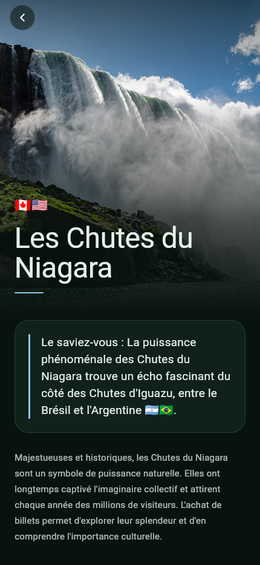</a></td><td align="center"><strong>18 — Great Smoky Mountains</strong><br><a href="docs/screenshots/18-great-smoky-mountains.png">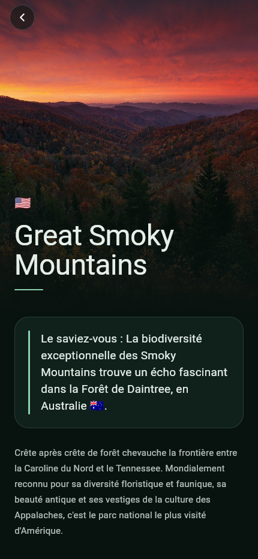</a></td></tr>
<tr><td align="center"><strong>19 — Shenandoah</strong><br><a href="docs/screenshots/19-shenandoah.png">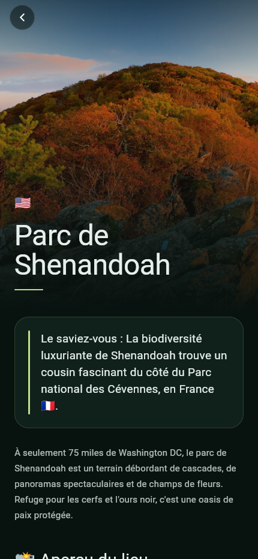</a></td><td align="center"><strong>20 — Voyageurs National Park</strong><br><a href="docs/screenshots/20-voyageurs-national-park.png">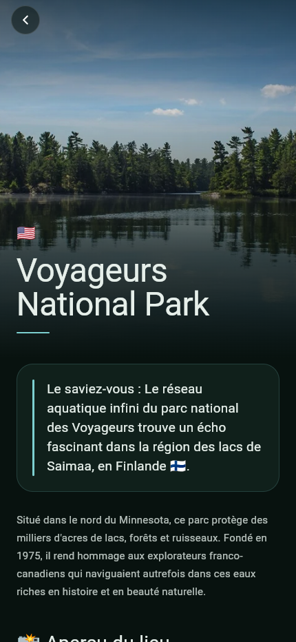</a></td><td></td></tr>
</table>

### 🏠 Écran d’accueil

<p align="center">
  <a href="docs/screenshots/01-accueil.png">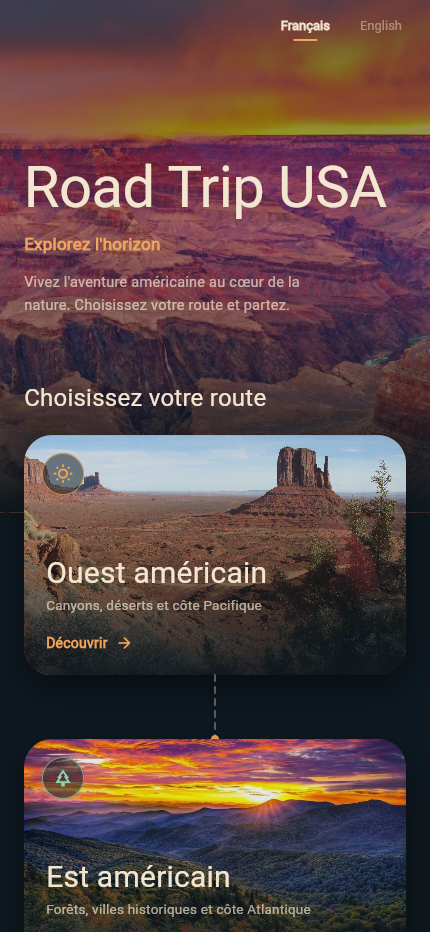</a><br>
  <strong>01 — Accueil</strong>
</p>

<sub>Cliquez sur une image pour consulter la capture originale. Chaque vignette correspond à un écran distinct de l’application.</sub>

## ✦ Fonctionnalités

- Choix entre l’Ouest et l’Est américains.
- Pages dédiées aux destinations et aux sites naturels.
- Fiches de découverte avec descriptions, visuels et informations pratiques.
- Possibilité de gérer les favoris.
- Navigation vers les emplacements sur une carte.
- Interface disponible en français et en anglais.

## ✦ Destinations présentées

**Ouest américain :** Grand Canyon, Monument Valley, Yellowstone, Death Valley, Antelope Canyon, Canyonlands, Bryce Canyon, Zion, Page et le lac Powell, la Vague pétrifiée, les Dunes peintes, le lac Mono et Fly Ranch Geyser.

**Est américain :** les Chutes du Niagara, Great Smoky Mountains, le parc de Shenandoah et Voyageurs National Park.

## ✦ Technologies

| TECHNOLOGIE | UTILISATION |
|:--|:--|
| **Flutter / Dart** | Application multiplateforme |
| **Flutter Localizations** | Prise en charge des langues |
| **Google Fonts** | Typographie |
| **Shared Preferences** | Conservation des favoris |
| **URL Launcher** | Ouverture de services et de liens externes |
| **GitHub Actions** | Déploiement Web et captures automatisées |
| **Playwright / Chromium** | Captures des écrans Flutter |

## ✦ Mise à jour automatique des captures

Le workflow GitHub Actions utilise `tool/screenshot_harness.dart` pour ouvrir les véritables widgets Flutter dans Chromium. Il capture chaque écran dans un viewport mobile standard de **430 × 932 px**, vérifie la présence des fichiers et contrôle que les images ne sont pas identiques avant de les enregistrer dans `docs/screenshots/`.

Le workflow se lance lors d’une mise à jour de la branche `main` ou manuellement depuis l’onglet **Actions**. Les captures représentent le rendu Web mobile des écrans Flutter ; elles ne sont pas des images promotionnelles.

## ✦ Installer le projet

Prérequis : Flutter installé et configuré.

```bash
git clone https://github.com/Coco921609/Usa.git
cd Usa
flutter pub get
flutter run
```

Pour générer la version Web :

```bash
flutter build web --base-href "/Usa/"
```

## ✦ Retrouver Road Trip USA

- **Application Web :** [Ouvrir Road Trip USA](https://coco921609.github.io/Usa/)
- **Dépôt GitHub :** [Coco921609/Usa](https://github.com/Coco921609/Usa)
- **Documentation Flutter :** [docs.flutter.dev](https://docs.flutter.dev/)

---

<p align="center">
  <strong>ROAD TRIP USA</strong><br>
  <em>Choisissez votre route. Explorez l’horizon.</em>
</p>


## ✦ Ouvrir ce projet Flutter dans Android Studio — Windows, macOS et Linux

Ce guide vous accompagne pour télécharger le code source de **Road Trip USA**, configurer Flutter et lancer le projet depuis Android Studio.

### 1. Télécharger le code source

Ouvrez un terminal (PowerShell sous Windows, Terminal sous macOS ou Linux) :

```bash
git clone https://github.com/Coco921609/Usa.git
cd Usa
```

Vous pouvez aussi télécharger le dépôt avec **Code → Download ZIP** sur GitHub, puis extraire l’archive.

### 2. Installer les outils nécessaires

Installez les outils suivants :

- **Flutter SDK :** [Guide officiel d’installation](https://docs.flutter.dev/get-started/install)
- **Android Studio :** [Télécharger Android Studio](https://developer.android.com/studio)
- **Git :** [Télécharger Git](https://git-scm.com/downloads)

Dans Android Studio, ouvrez **Settings / Preferences → Plugins**, recherchez **Flutter** et installez-le. Le plugin Dart sera également proposé.

### 3. Windows — installation et ouverture

1. Installez Flutter pour Windows et ajoutez le dossier `flutter/bin` à la variable d’environnement `Path`.
2. Installez Git et Android Studio.
3. Ouvrez PowerShell et vérifiez votre installation :

```powershell
flutter doctor
```

4. Dans Android Studio, cliquez sur **Open**, puis sélectionnez le dossier `Usa`, celui qui contient le fichier `pubspec.yaml`.
5. Dans le terminal intégré d’Android Studio, exécutez :

```bash
flutter pub get
flutter devices
flutter run
```

### 4. macOS — installation et ouverture

1. Installez Flutter pour macOS, Git et Android Studio.
2. Pour développer et lancer la version iOS, installez **Xcode** depuis le Mac App Store. Puis configurez les outils Apple :

```bash
sudo xcode-select --switch /Applications/Xcode.app/Contents/Developer
sudo xcodebuild -runFirstLaunch
flutter doctor
```

3. Depuis le terminal, placez-vous dans le dossier `Usa`, puis ouvrez Android Studio :

```bash
cd Usa
open -a "Android Studio" .
```

4. Dans le terminal intégré, installez les dépendances et lancez le projet :

```bash
flutter pub get
flutter devices
flutter run
```

Pour iOS, sélectionnez un simulateur iPhone ou un iPhone connecté dans Android Studio ou Xcode.

### 5. Linux — installation et ouverture

1. Installez Flutter pour votre distribution Linux, Git et les dépendances système indiquées dans le [guide Flutter pour Linux](https://docs.flutter.dev/get-started/install/linux).
2. Installez Android Studio et configurez le SDK Android depuis **More Actions → SDK Manager**.
3. Vérifiez l’installation :

```bash
flutter doctor
```

4. Dans le terminal, ouvrez le dossier du projet dans Android Studio :

```bash
cd Usa
studio .
```

5. Dans le terminal intégré d’Android Studio, exécutez :

```bash
flutter pub get
flutter devices
flutter run
```

Si `studio .` n’est pas reconnu, ouvrez Android Studio manuellement avec **Open**, puis sélectionnez le dossier `Usa`.

**Important pour iOS :** la compilation et l’exécution iOS nécessitent un Mac équipé de Xcode. Elles ne sont pas possibles directement depuis Windows ou Linux.

### 6. Télécharger ou découvrir Road Trip USA

- **Android (Google Play) :** [Télécharger Road Trip USA](https://play.google.com/store/apps/details?id=com.stats.usa)
- **iOS / Web :** [Ouvrir Road Trip USA](https://coco921609.github.io/Usa/)
- **Code source :** [Coco921609/Usa sur GitHub](https://github.com/Coco921609/Usa)

